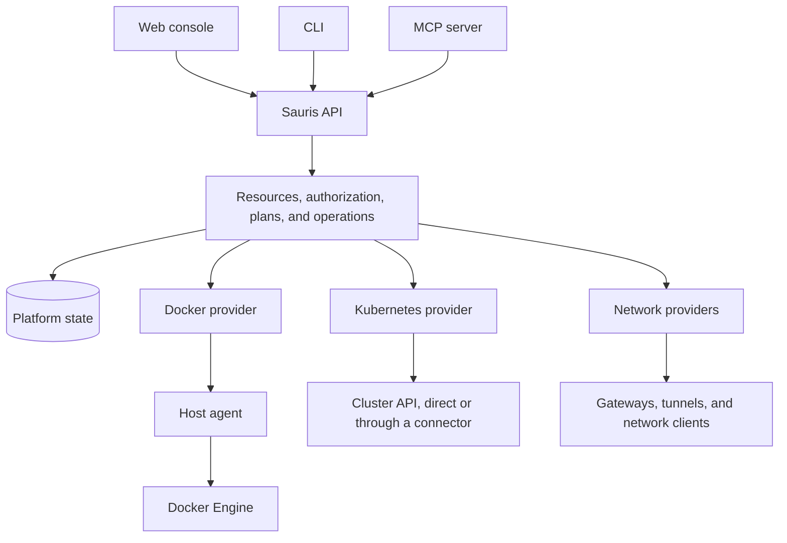

# Sauris

**The open-source, self-hosted personal cloud for people and AI agents.**

Sauris is being built to bring your servers, containers, Kubernetes clusters, and private networks into one platform. Deploy applications, connect machines, and control access through a web console, CLI, or MCP server, with shared permissions and a clear record of what changed.

- **Run on your infrastructure.** Connect existing Docker hosts and Kubernetes clusters without requiring Kubernetes to run Sauris itself.
- **Connect your machines and services.** Manage private connectivity, tunnels, application routes, and identity-based access as separate capabilities that work together.
- **Work with people and agents.** Use the console, scripts, or an AI client against the same resource model, authorization, and execution flow.

## Build from source

You need **Go 1.26 or newer**. Make is optional. The scaffold uses only the Go standard library and does not require Docker, Kubernetes, a database, or a model API key.

```bash
go run ./cmd/sauris version
make check
./bin/sauris --help
```

Without Make:

```bash
go test ./...
go vet ./...
go build ./...
```

The module path is `github.com/saurlax/sauris`. No Git remote or hosted repository is configured by this scaffold.

## Choose how you work

These are planned interfaces, not commands or services available today.

| Interface | Intended use |
| --- | --- |
| **Console** | Inspect infrastructure, review changes, deploy applications, and diagnose failures. |
| **CLI** | Manage resources interactively or through scripts and CI, with structured output and operation tracking. |
| **MCP** | Let AI clients discover capabilities, inspect evidence, plan changes, and execute within delegated permissions. |
| **HTTP API** | Integrate Sauris into other tools and provide the shared platform boundary for all interfaces. |

The platform will not require a model service to operate. An optional built-in assistant can use the same tools and permissions as external agents.

## Connect compute and networking

Compute and networking have independent resource lifecycles. A service endpoint connects them: it describes a reachable service without requiring a gateway to understand its container runtime.

| Area | Planned scope |
| --- | --- |
| **Infrastructure** | Host enrollment, inventory, capabilities, health, and existing cluster connections. |
| **Compute** | Docker applications first, followed by Kubernetes integration with explicit backend capabilities. |
| **Delivery** | Git connections, isolated builds, image delivery, deployment history, and rollback. |
| **Networking** | Private networks, subnet routes, reverse tunnels, application gateways, and optional forward proxies. |
| **Access** | User and machine identities, scoped credentials, resource policies, and audit records. |
| **Operations** | Logs, events, structured diagnostics, persistent volumes, and backup and recovery workflows. |

Sauris will integrate existing runtimes and networking tools through providers. It will not initially implement its own container scheduler, VPN protocol, or virtual machine infrastructure.

## How the platform fits together



The intended execution flow is **Intent → Observe → Plan → Execute → Observe**. An application records desired configuration; a plan describes proposed changes; an operation records a particular execution. Background controllers track convergence and failures.

Providers translate platform intent into backend-specific actions. Transports determine how Sauris reaches a backend. Docker and Kubernetes share common application concepts while retaining their own scheduling, rollout, storage, and concurrency semantics.

Sauris stores platform-owned intent, relationships, authorization, and operation history. Providers report observed runtime state. Existing resources are discovered without automatically transferring ownership to Sauris.

See the [architecture guide](docs/architecture.md) for boundaries and deployment direction.

## Work from source

This is a single Go module with multiple packages and executable entry points. Keep new packages internal until there is a concrete reason to publish an API.

| Path | Purpose |
| --- | --- |
| `cmd/sauris` | CLI entry point. |
| `cmd/sauris-server` | Control-plane entry point. |
| `cmd/sauris-agent` | Host-agent entry point. |
| `internal/command` | Shared bootstrap help and version handling. |
| `internal/buildinfo` | Build metadata. |
| `docs` | Architecture and development documentation. |
| `openspec/specs` | Architectural requirements; these do not imply implementation is complete. |
| `openspec/changes` | Proposals, designs, specifications, and implementation tasks for active changes. |
| `.agents/skills` | Project-local OpenSpec workflows generated for Codex. |

```bash
make fmt
make check
```

## Develop with OpenSpec

The repository is initialized with **OpenSpec 1.11.0**, the `spec-driven` schema, and Codex integration. Install the matching CLI if needed:

```bash
npm install -g @fission-ai/openspec@1.11.0
openspec list --specs
openspec validate --all --strict --no-interactive
```

In Codex, start a feature with `$openspec-propose`, implement an agreed change with `$openspec-apply-change`, and archive completed work with `$openspec-archive-change`. The CLI equivalent for starting a change is `openspec new change <change-name>`; follow `openspec status --change <change-name>` for artifact progress.

Read [AGENTS.md](AGENTS.md) and the [OpenSpec guide](openspec/README.md) before changing platform contracts.
